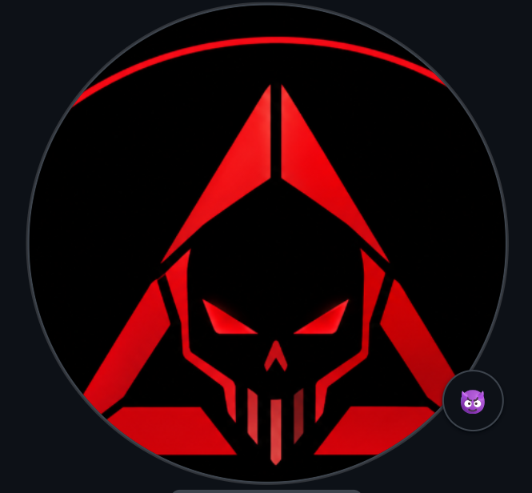

<div align="center">
  
</div>

<br/>

<table border="0" style="border-collapse: collapse;">
<tr>
<td width="40%" valign="top" align="center">



</td>
<td width="60%" valign="top">

```text
anuj-Overclocked@github
-------------------------
OS: Windows 11, Linux, Android
Uptime: 20 years
Host: Developer Student
Kernel: Software Engineer
IDE: VS Code, IntelliJ, Android Studio

Languages.Programming: Java, Python, JavaScript, Dart, PHP, CSS, HTML
Languages.Real: English, Hindi

Hobbies.Software: App Development, Web Development, Open Source
Hobbies.Hardware: PC Building, Overclocking

Contact
Email.Personal: your.email@example.com
LinkedIn: your-linkedin-username
GitHub: anuj-Overclocked

GitHub Stats
---------------------------------
Repos:      13 (Public)
Stars:      2
Followers:  [Your Followers]
Following:  [Your Following]
